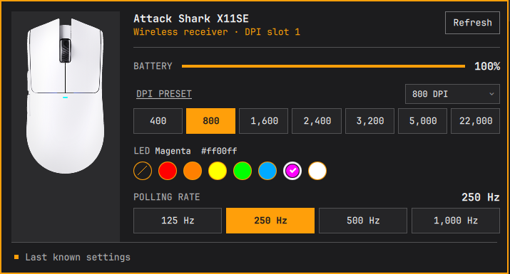

# Omarchy X11SE Mouse

An Omarchy bar widget and standalone CLI for the Attack Shark X11SE, connected by USB cable or its 2.4 GHz receiver. Hover over the mouse icon for battery, DPI and polling-rate status; click it to open the settings panel.

**Requirements:** Omarchy Quattro, Python 3.10 or newer (standard library only), and an X11SE connected by USB or its 2.4 GHz receiver. Other Attack Shark models are not currently supported.



## Install

Install the plugin from Omarchy:

```sh
omarchy plugin add https://github.com/TraiNguyenVan/omarchy-x11se-mouse.git --enable
```

The receiver and wired mouse expose settings through `hidraw` interface 02 (USB VID:PID `1d57:fa60` and `1d57:2125`, respectively). Install the matching udev rules with one sudo authorization:

```sh
sudo ~/.config/omarchy/plugins/trai.x11se-mouse/scripts/install-udev-rule.sh
```

Reconnect the receiver or cable after setup. The udev rule uses `TAG+="uaccess"` to grant read and write access to your active desktop session without modifying system group memberships or requiring a logout. The plugin itself does not use sudo; normal status reads and settings changes run as your user.

## Remove

Remove the plugin and its device rule:

```sh
omarchy plugin remove trai.x11se-mouse
sudo rm -f /etc/udev/rules.d/70-x11se-hidraw.rules /etc/udev/rules.d/99-x11se-hidraw.rules
sudo udevadm control --reload-rules
sudo udevadm trigger --subsystem-match=hidraw
```

If an older installation previously added your account to the `input` group and you no longer need that membership for other devices, you can remove it with `sudo gpasswd -d "$USER" input`.

## Using the panel

Click the mouse icon in the bar to open the panel. Select a DPI preset or polling rate to change the mouse setting. The dashed outline indicates a change is being applied; the filled button shows the last known or confirmed setting. Use **Refresh** to read current settings from the connected mouse.

The default DPI presets are 400, 800, 1,600, 2,400, 3,200, 5,000 and 22,000. Click the underlined **DPI PRESET** label to choose seven different values for the preset board. Saving the board does not change the current DPI. Presets are saved in `${XDG_CONFIG_HOME:-~/.config}/omarchy/x11se-presets.json`.

The DPI dropdown contains 33 values confirmed by receiver readback during testing; it is not a complete scan of the mouse’s supported range. The preset editor also includes the seven defaults. Available polling rates are 125, 250, 500 and 1,000 Hz.

Hover over the mouse illustration to reveal six clickable appearance choices. These change the illustration manually; the plugin does not detect the physical mouse color.

When using the 2.4 GHz receiver, the LED section is a single row: an **Off** circle followed by seven color circles. **Off** clears the effect and leaves the other lighting bytes unchanged, including when the current effect is one this plugin does not otherwise control. Picking a color stores it and, if the LED is off, turns it back on in Static mode. The ring marks the current state: the Off circle while off, otherwise the active color. LED control over USB is refused.

The plugin prefers the wired connection when both are present and switches back to the receiver when the cable is disconnected. The bar’s watcher listens for battery events without periodically polling settings. Some displayed values can be cached; use **Refresh** to request current settings.

## CLI

Run the CLI from the plugin directory, `~/.config/omarchy/plugins/trai.x11se-mouse`. Device commands require the permission setup described above.

```sh
./bin/x11se-mouse status
./bin/x11se-mouse status --json
./bin/x11se-mouse set-dpi 800
./bin/x11se-mouse set-polling 500
./bin/x11se-mouse get-lighting
./bin/x11se-mouse set-light-color '#00ff00'
./bin/x11se-mouse set-light-power on
./bin/x11se-mouse capabilities
```

The bar starts `watch` automatically. Run `./bin/x11se-mouse watch` to inspect its JSON event stream, or add `--debug` to a device command for Python tracebacks. `capabilities` prints the X11SE model descriptor without accessing the receiver. Run `./bin/x11se-mouse --help` for all options.

DPI and polling changes are checked using readback. For receiver changes, if an acknowledgement is missing but readback confirms the requested setting, the CLI reports success with a warning. Wired changes are verified by readback without relying on an acknowledgement. Mismatches and failed readbacks are reported as errors.

## Development

Run the device-free protocol and CLI tests with:

```sh
python -m unittest discover -s tests -v
```

See [DEVELOPING.md](DEVELOPING.md) for the model boundary and the evidence needed to add another mouse.

## License

MIT. See [LICENSE](LICENSE).
