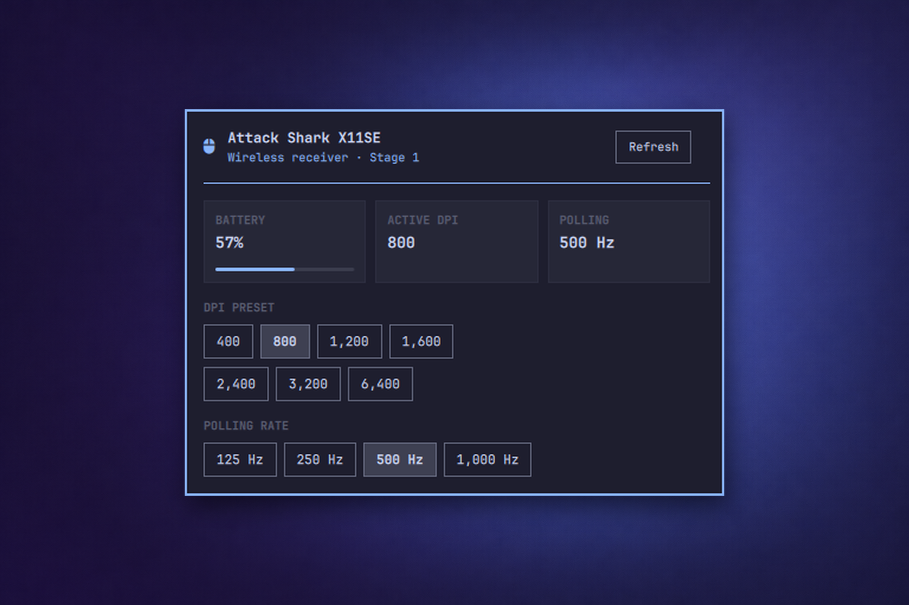
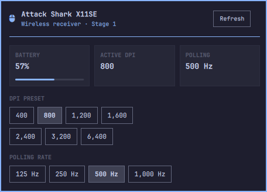

# Omarchy X11SE Mouse

An Omarchy bar widget and standalone CLI for the Attack Shark X11SE 2.4 GHz receiver. The bar shows battery, active DPI, and polling rate; click the mouse icon to choose a fixed DPI preset or polling rate.



<details>
<summary>View the original cropped panel capture</summary>



</details>

## Install

Install the plugin from Omarchy:

```sh
omarchy plugin add https://github.com/TraiNguyenVan/omarchy-x11se-mouse.git --enable
```

The receiver exposes its settings through `hidraw` interface 02 (USB VID:PID `1d57:fa60`). Install the matching udev rule and grant your account access to the `input` group with one sudo authorization:

```sh
sudo ~/.config/omarchy/plugins/trai.x11se-mouse/scripts/install-udev-rule.sh
```

Reconnect the receiver after setup. If the script adds your account to `input`, log out and back in for the new group membership to take effect. The plugin itself does not use sudo; normal status reads and settings changes run as your user.

## CLI

The CLI runs without Quickshell and requires the receiver's udev permission above:

```sh
./bin/x11se-mouse status
./bin/x11se-mouse status --json
./bin/x11se-mouse set-dpi 800
./bin/x11se-mouse set-polling 500
./bin/x11se-mouse watch
```

`watch` listens for battery events and replays the last known settings from the state cache. It does not poll feature reports. `status` reads current settings on demand. Polling changes are verified by reading the selected rate back from the receiver, including when its acknowledgement is missing.

Run protocol tests without a mouse attached:

```sh
python -m unittest discover -s tests -v
```

## DPI presets

The panel offers 400, 800, 1,200, 1,600, 2,400, 3,200, and 6,400 DPI. Protocol tests verify that each preset round-trips through the receiver's encoding. DPI and polling writes have been exercised on an X11SE receiver.

## License

MIT. See [LICENSE](LICENSE).
